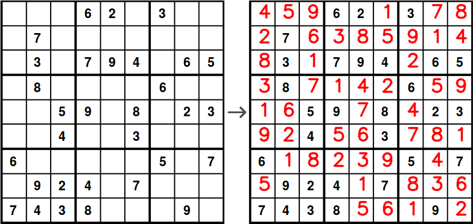
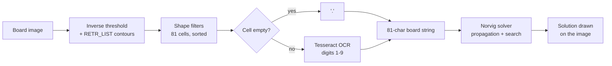

# Sudoku Vision Solver

Reads a printed Sudoku from an image and solves it: OpenCV contour filtering to find the 81 cells, Tesseract OCR to read the clues, and Peter Norvig's constraint-propagation solver, with the solution drawn back onto the image.



**Run it in Colab:** [](https://colab.research.google.com/github/santiagodie/sudoku-vision-solver/blob/main/02_digit_recognition_and_solving.ipynb) (*Runtime → Run all*; the notebook clones this repository and installs Tesseract).

## Overview

Given an image of a printed Sudoku, the pipeline locates the grid, decides which cells are empty, recognises the digit in each filled cell, solves the puzzle and writes the missing digits into the original image. It is split into two notebooks:

| Notebook | Step | Key result |
| --- | --- | --- |
| `01_grid_detection.ipynb` | Grid and empty-cell detection | Exactly 81 cells kept out of 122–131 contours per board; an empty/filled mask for each one |
| `02_digit_recognition_and_solving.ipynb` | Digit recognition, solving and drawing | 86/86 clues read correctly with Tesseract; each board solved in about 2.5 ms |

The second notebook also documents a first approach that did not work, a Random Forest trained on handwritten digits, and measures why.

Built from two exercises of the Artificial Intelligence course at the University of La Rioja (2025–26).

## Features

- **Grid detection:** inverse threshold, `RETR_LIST` contours and three shape filters (solidity > 0.9, aspect ratio 0.8–1.2, area 1,000–15,000 px²) isolate exactly the 81 cells. The detector raises an error if it finds any other number, instead of producing a shifted board.
- **Empty-cell detection:** each cell is cropped with a 5 px margin to exclude the grid lines; an empty cell is then pure background.
- **Digit recognition, first attempt:** a Random Forest (406 trees) trained on 2,560 handwritten MNIST-style digits, with 92.3% accuracy on its own test set. On the printed boards it reads only 13% of the clues.
- **Digit recognition with Tesseract:** inverted, upscaled and padded crops, page segmentation mode 6 and a 1–9 whitelist. If a pass does not return exactly one digit, it retries without blur, and fails loudly if that also fails.
- **Solver:** Norvig's constraint propagation plus depth-first search, with every solution checked by his `is_solution`.
- **Output:** the missing digits are drawn in red into the empty cells of the original image.

## Tech stack

Python · Jupyter / Google Colab · OpenCV · Tesseract (`pytesseract`) · scikit-learn · NumPy · Matplotlib

## How it works



Boards travel through the pipeline as 81-character strings read row by row, the format Norvig's `parse` accepts: `.` for an empty cell and the digit otherwise. Notebook 01 produces an intermediate version with `?` for every filled cell.

**Measured results** (from the saved notebook outputs; 3 boards, 86 clues in total):

| Recognition approach | Clues read correctly |
| --- | --- |
| Random Forest, whole cell resized to 28×28 | 11/86 (13%) |
| Random Forest, digit cropped and centred as in MNIST | 42/86 (49%) |
| Tesseract | 86/86 (100%) |

**Why the Random Forest failed.** The first version resized each whole cell to 28×28, so the digit filled only a small part of the input, while MNIST digits are cropped, scaled to a 20×20 box and centred. Reproducing that framing raises accuracy from 13% to 49%. The remaining gap comes from the training data itself: handwritten digits do not look like a printed typeface. Rather than training a new model on printed digits, the pipeline switched to Tesseract, which is built for printed text.

**The Tesseract version issue.** The original configuration, with a 5×5 Gaussian blur, read every clue on Colab's Tesseract 4.1.1. Running it again on Tesseract 5.3.4 returned an empty string for two of the 9s. Because the board is a string, a missing character silently shifts every later cell, so the solver receives a wrong but plausible board. `read_digit` now retries without blur when the result is not a single digit (the two retries visible in the notebook output) and raises an error if the retry fails too.

## Getting started

**Requirements**

- Python 3.12 (tested) and the Tesseract binary (`apt install tesseract-ocr` on Debian/Ubuntu, `brew install tesseract` on macOS, or the [UB Mannheim installer](https://github.com/UB-Mannheim/tesseract/wiki) on Windows).
- The Python packages in `requirements.txt`, pinned to the versions the notebooks were last run with:

```bash
pip install -r requirements.txt
```

**Running**

From the repository root, open the notebooks in Jupyter and run them in order. Notebook 02 is self-contained and can also be run on its own. Both notebooks have an "Open in Colab" badge and set themselves up when they detect Colab.

The saved outputs come from Tesseract 5.3.4 with the versions in `requirements.txt`. The original course runs used Colab with Tesseract 4.1.1.

## Data

Everything the notebooks need is in `data/`, so they do not depend on external downloads:

| Path | Contents | Source |
| --- | --- | --- |
| `data/boards/` | Three 372×372 px Sudoku boards | Printable puzzles from [sudoku-online.org](http://www.sudoku-online.org/imprimir-sudokus.php), distributed with the course materials |
| `data/digits/` | 2,560 handwritten digits, 28×28 px, 256 per class | Course materials |

These files are not covered by the MIT License of this repository (see [License](#license)).

## Known limitations

- **Only three boards.** All of them are clean, computer-generated images from the same site at the same resolution. The threshold (30) and the cell-area range (1,000–15,000 px²) are tied to that resolution, and the Tesseract configuration was tuned on these 86 clues.
- **No photographs.** There is no perspective correction, so a photographed, rotated or unevenly lit board will not produce 81 clean cells. The detector raises an error rather than guessing.
- **Row sorting assumes perfect alignment.** `sort_contours` orders cells by the exact `y` of their bounding box, which works because every row of these boards shares the same `y`. A skewed board would need a tolerance when grouping rows.
- **Hand-made reference.** Recognition accuracy is measured against boards transcribed by hand from the images.
- **The framing experiment is a diagnostic.** The MNIST-style preprocessing was added to explain the Random Forest's failure, not tuned to make it competitive.

## What I learned

- **Good test metrics do not transfer across domains.** A model with 92% accuracy on handwritten digits read 13% of printed ones. Its numbers described its own dataset, not this task.
- **Preprocessing has to match what the model saw in training.** Part of that failure was framing, not the model: cropping and centring the digit as in MNIST fixed 31 of the 75 errors and nearly quadrupled the accuracy.
- **Silent failures are worse than crashes.** One empty OCR result shifted the whole board string without any error. Checking invariants (exactly 81 cells, exactly one digit per filled cell, a valid solution) turns those cases into explicit errors.
- **OCR results depend on the engine version.** The same code and configuration gave different results on Tesseract 4 and 5, so the version belongs in the documentation along with the results.

## Credits

- The Artificial Intelligence course at the University of La Rioja provided the exercise design, the `show_image` and `sort_contours` helpers, the digit-loading code the `load_digits` function is adapted from, and both datasets.
- [Peter Norvig's Sudoku solver](https://github.com/norvig/pytudes/blob/main/ipynb/Sudoku.ipynb) from pytudes, included in notebook 02 under the MIT License (see `THIRD_PARTY_NOTICES.md`).
- Sudoku boards from [sudoku-online.org](http://www.sudoku-online.org/imprimir-sudokus.php).
- [Tesseract OCR](https://github.com/tesseract-ocr/tesseract) and [pytesseract](https://github.com/madmaze/pytesseract).

AI assistance was used to restructure and translate the notebooks into English. It also helped add the MNIST-style framing experiment and the OCR retry.

## License

The code is released under the [MIT License](LICENSE). Norvig's solver keeps its own MIT License notice ([`THIRD_PARTY_NOTICES.md`](THIRD_PARTY_NOTICES.md)). The license does not cover the boards or the digit dataset in `data/`.
